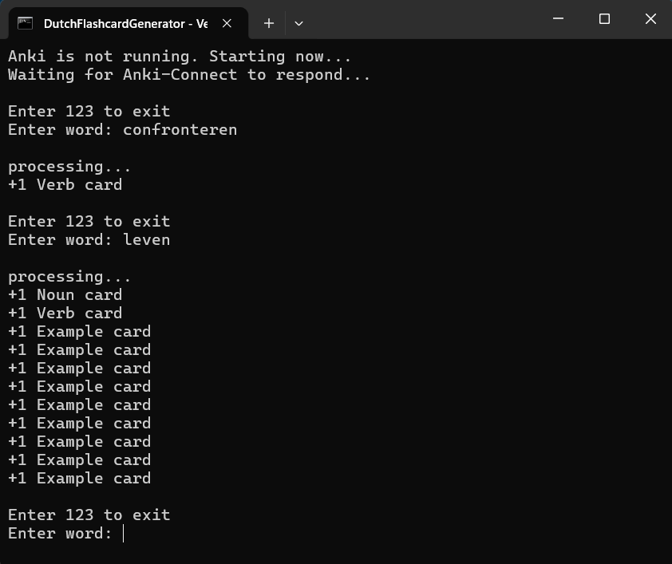
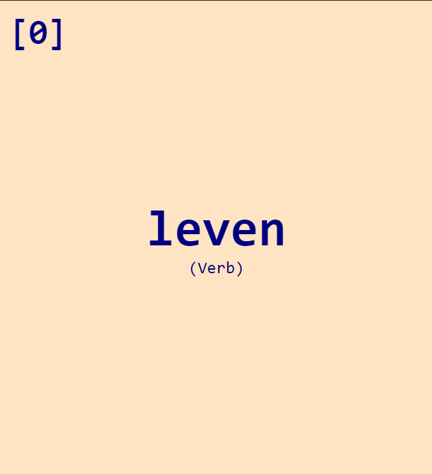
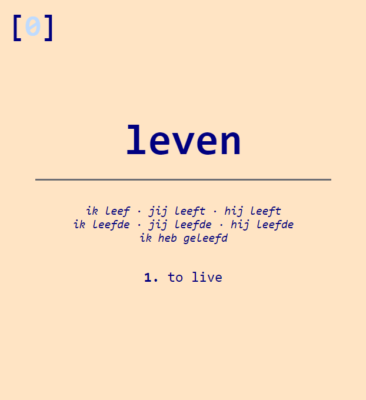
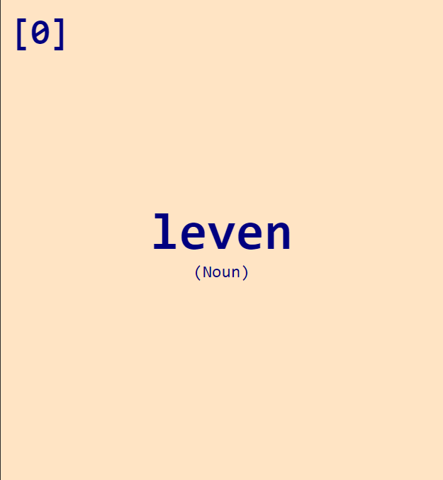
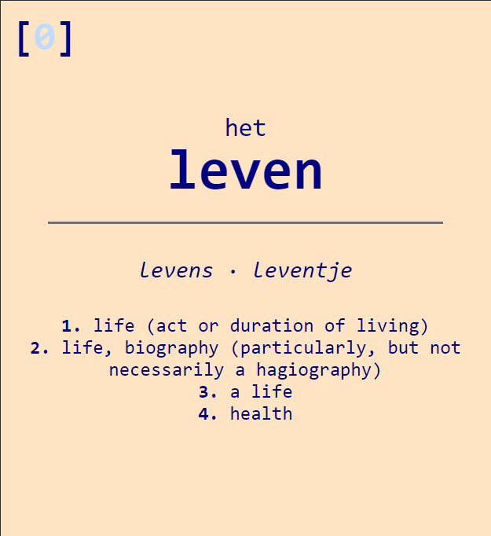
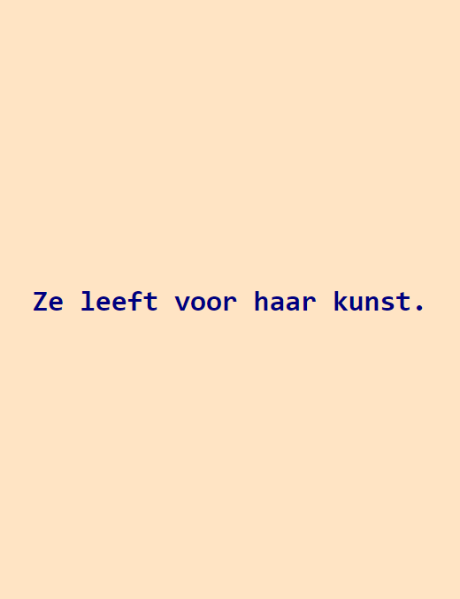

# Dutch Anki Card Generator

A simple script with a command line interface that automatically generates well formatted [anki](https://apps.ankiweb.net/) cards using scraped data from [wiktionary](https://en.wiktionary.org/wiki/Wiktionary:Main_Page) and [mijnwoordenboek](https://www.mijnwoordenboek.nl/ww.php).

## Terminal
**The user is greeted with a simple input prompt. Upon entering a word cards are generated accordingly as per the wiktionary entry.**

## Cards

**Verb cards are fitted with conjugations and an indey top left for multiple meanings with a link to the wiktionary page.**

| Frontside | Backside |
| :---: | :---: |
|  |  |

##

**Noun cards are fitted with the corresponding article and diminutive + plural forms. Indexing with wiktionary link also included.**

| Frontside | Backside |
| :---: | :---: |
|  |  |

##

**Example sentences with translations included in the wiktionary card are also included as seperate cards.**

| Frontside | Backside |
| :---: | :---: |
|  |  |

##